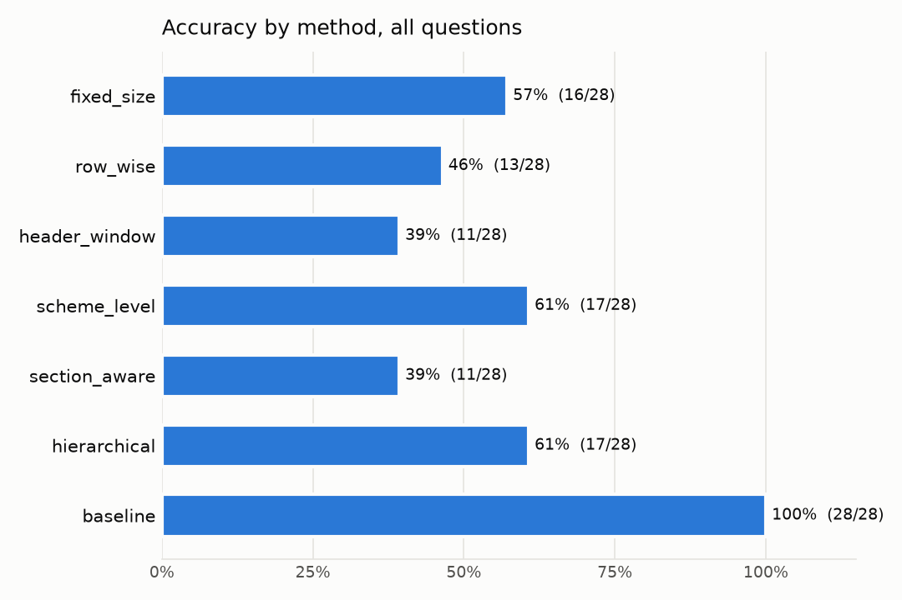

# Mutual Fund Portfolio Analyzer

Ask plain-English questions about Indian mutual fund portfolio disclosures (the monthly Excel files every fund house publishes), and find out **which way of chunking those tables works best for RAG**.

The main deliverable is an experiment, not the app. Six chunking strategies are built on the same parsed data, plus one approach with no chunking at all (the LLM writes pandas code). All seven methods answer the same 28 questions, and every answer is scored against a gold answer computed from the data. The result is in [`results/chunking_report.xlsx`](results/chunking_report.xlsx) and [`results/summary.md`](results/summary.md).

**Result in one line:** the best chunker for this data is **hierarchical** (17/28 correct, tied with scheme_level and ahead on retrieval). No chunker comes close to the pandas baseline (28/28), especially on totals and counts.

---

## Findings

Recorded run of 20 Nov 2026: Grok `x-ai/grok-4.20`, temperature 0. The data is Aditya Birla Sun Life (ABSL), 30 Sep 2026. Embeddings come from `BAAI/bge-small-en-v1.5` with top_k 5. That gives 7 methods × 28 questions = 196 answers, all from the same model.

### Accuracy

| Method | lookup (7) | aggregation (7) | debt (5) | cross_scheme (5) | unanswerable (4) | **overall (28)** |
| --- | ---: | ---: | ---: | ---: | ---: | ---: |
| **hierarchical** | 100% | 43% | 20% | 40% | 100% | **61% (17)** |
| scheme_level | 100% | 43% | 0% | 60% | 100% | **61% (17)** |
| fixed_size | 100% | 29% | 0% | 60% | 100% | 57% (16) |
| row_wise | 100% | 0% | 0% | 40% | 100% | 46% (13) |
| header_window | 86% | 14% | 0% | 0% | 100% | 39% (11) |
| section_aware | 86% | 14% | 0% | 0% | 100% | 39% (11) |
| *pandas baseline (not ranked)* | 100% | 100% | 100% | 100% | 100% | *100% (28)* |



### What the run answers

1. **Which chunker is best for which question?**
   - **Lookups** ("what % of fund X is in stock Y?"): almost every chunker gets all 7 right. row_wise does it with the smallest prompts.
   - **Aggregations and debt questions:** hierarchical and scheme_level do best, but even they get fewer than half right.
   - **Cross-scheme comparisons:** scheme_level does best (60%).
   - **Unanswerable questions:** every method correctly says the data does not hold the answer.
2. **Did retrieval fail or generation fail?** It depends on the chunk size.
   - The small-chunk methods (fixed_size, row_wise, header_window, section_aware) fail mostly on **retrieval**: the rows the answer needs never reach the LLM. Only 51–65% of the needed rows reach the model.
   - scheme_level and hierarchical get 92–96% of the needed rows into the prompt. Their wrong answers are mostly **generation errors**: the rows were there, but the LLM added them up wrong.
3. **What does each method cost?** Mean prompt tokens per question:

   | Method | Prompt tokens |
   | --- | ---: |
   | row_wise | about 1,000 |
   | hierarchical | about 7,100 |
   | scheme_level | about 14,100 |

   Answers take about 2 s for the small-chunk methods and about 4 s for the large ones. hierarchical matches scheme_level's accuracy for half the tokens. That, plus its higher retrieval, is why it wins the tie.
4. **Does the pandas baseline beat RAG on aggregations?** Yes, clearly: 7/7 against 3/7 for the best chunker. When a question needs exact arithmetic over many rows, letting the LLM write code over the whole table beats any chunking.

### Limits of this result

- **Small question set:** 28 questions, so a 1-question gap could be noise. The top two chunkers are tied on correct answers.
- **One fund house, one month:** only ABSL, 30 Sep 2026.
- **Cut-off replies:** 6 answers broke the JSON format because the reply hit `max_output_tokens` (2,000). They count as wrong.
- **Token overhead:** the Grok endpoint adds about 180 prompt tokens to every call. This is the same for every method, so it does not change the ranking.

Full detail: the [Excel report](results/chunking_report.xlsx) has a Recommendation sheet, a Ranking, accuracy by question type, retrieval and cost, every answer, and run info. See also [`results/summary.md`](results/summary.md) and [`results/run_manifest.json`](results/run_manifest.json).

---

## The seven methods

| Method | How it cuts the table | Idea behind it |
| --- | --- | --- |
| `fixed_size` | Flattens the sheet to text, every 256 tokens with 32 overlap | The naive reference point; ignores the table |
| `row_wise` | One chunk per holding, every field labelled | Precise lookups |
| `header_window` | 10 rows per chunk, header repeated | Middle ground; never cuts a row |
| `scheme_level` | The whole scheme in one chunk | Full context for totals |
| `section_aware` | One chunk per section (Equity, Debt, …), split if too long | Matches how a person reads the sheet |
| `hierarchical` | Searches single rows, answers from their whole section | Row-level search with section-level context |
| `baseline` | No chunking: the LLM writes pandas code, which runs in a sandbox | Exact arithmetic over all rows |

Why each one exists and what was expected: [`docs/SPEC.md`](docs/SPEC.md) §6.3.

---

## Setup (Windows)

### 1. Python and packages

You need **Python 3.11**.

```powershell
py -3.11 -m venv .venv
.venv\Scripts\activate
pip install -r requirements.txt
```

`requirements-lock.txt` pins every package, including dependencies, for an exact rebuild. The first run downloads the embedding model (about 130 MB) once.

### 2. API keys

Copy `.env.example` to `.env` and fill it in. `.env` is git-ignored, so never commit it.

| Variable | Needed for |
| --- | --- |
| `GROK_API_KEY` | The main LLM, Grok (paid) |
| `GROQ_API_KEY` | The fallback when Grok is rate-limited or out of credit (free tier) |
| `XAI_API_KEY`, `GEMINI_API_KEY` | Optional, other providers |
| `LLM_PROVIDER`, `LLM_FALLBACK` | Optional; they override `config.yaml` |

Grok is the main LLM and Groq the fallback, both in `config.yaml` and in the example file. Any row the fallback answers is flagged and re-asked by the evaluation, so recorded results always come from the main model. `LLM_PROVIDER=mock` runs everything offline with a fixed answer.

### 3. Data

The raw files are public but large, so they are not in git. Download the ABSL monthly portfolio disclosures from the [Aditya Birla Sun Life Mutual Fund website](https://mutualfund.adityabirlacapital.com/forms-and-downloads/portfolio): **Downloads → Portfolio → Monthly Portfolio**. Put the `.xls` files in `data/raw/` and keep their original names:

```
data/raw/
  ABSL_Monthly_Portfolio_Report_July 2026.xls
  31082026_ABSLMF_MonthlyDisclosure.xls
  30092026_ABSLMF_MonthlyDisclosure.xls   <- the evaluation month
  31102026_ABSLMF_MonthlyDisclosure.xls
```

Only September is needed for the evaluation (`data.eval_months` in `config.yaml`). The parser reads any file matching `*ABSL*.xls`, and takes the month from each sheet's title row, not the file name. The layout of these files, and the parser rules it led to, are in [`docs/DATA_NOTES.md`](docs/DATA_NOTES.md).

---

## Run it: the five commands

```powershell
python -m src.parsing                                   # parse data/raw -> data/processed/*.parquet + results/parse_report.md
python -m src.index --month 2026-09-30 --chunkers all   # chunk, embed and store every chunker in Chroma (data/chroma)
python -m src.eval run                                  # every method x every question -> results/results.csv
python -m src.eval report                               # -> results/summary.md, accuracy_by_method.png, chunking_report.xlsx
streamlit run app/streamlit_app.py                      # the app
```

- **`eval run`:** resumes where it stopped. Rows that hit a rate limit, an outage or the fallback stay *pending* and are asked again on the next run. `--fresh` starts a new recorded run and skips the LLM cache. `--methods` and `--questions` limit a run, for smoke tests.
- **`eval report`:** needs no LLM calls. It rebuilds the reports from `results.csv`.

### The app

Three pages:

- **Ask:** one question through one method, with the cited rows, the retrieved chunks, tokens and latency.
- **Compare:** one question through all seven methods side by side.
- **Results:** the recommendation card, the Excel download and the tables.

The app only reads what `src.parsing` and `src.index` built.

### Other commands

| Command | What it does |
| --- | --- |
| `python -m src.rag "question" [--chunker NAME] [--scheme CODE]` | One question through RAG → `results/rag_sample.md` |
| `python -m src.baseline "question" [--show-schema]` | One question through the pandas baseline → `results/baseline_sample.md` |
| `python -m src.chunking` | Chunk counts and samples without embedding → `results/chunk_stats.md`, `chunk_samples.md` |
| `python -m src.eval gold` | Every gold answer → `results/gold_answers.md` |
| `python -m src.eval manual-check` | A sample of questions to check by hand → `results/manual_check.md` |
| `python -m src.eval rescore --reason "..."` | Re-score stored answers after a metric change (no LLM calls) |
| `python -m src.llm models grok` | List the models a provider offers |
| `pytest` | All tests. They run offline on synthetic files; the real-file smoke test is skipped if the Sep file is missing |

---

## Project layout

```
config.yaml            all tunable values (paths, models, chunk sizes, top_k, LLM settings)
src/parsing/           .xls -> clean holdings table (xlrd), with validation against each sheet's grand total
src/chunking/          the six chunkers, sharing one chunk format and token counter
src/index/             embeddings (bge-small, disk-cached) and the Chroma collections
src/rag/               retrieval, prompt, answer with cited source rows
src/baseline/          text-to-pandas: schema prompt, code guard, sandbox
src/llm.py             one LLM interface: grok / xai / groq / gemini / mock, retries, cache, fallback
src/eval/              questions.yaml, gold answers, metrics, the runner, reports, the recommendation
app/                   Streamlit app (Ask, Compare, Results)
tests/                 pytest suite
results/               committed deliverables: results.csv, summary.md, chunking_report.xlsx, ...
docs/                  SPEC.md (what and how it is judged), IMPLEMENTATION_PLAN.md (phases, decisions), DATA_NOTES.md
```

Git-ignored: `.venv/`, `.env`, `data/raw/`, `data/processed/`, `data/chroma/`, `data/cache/`.
