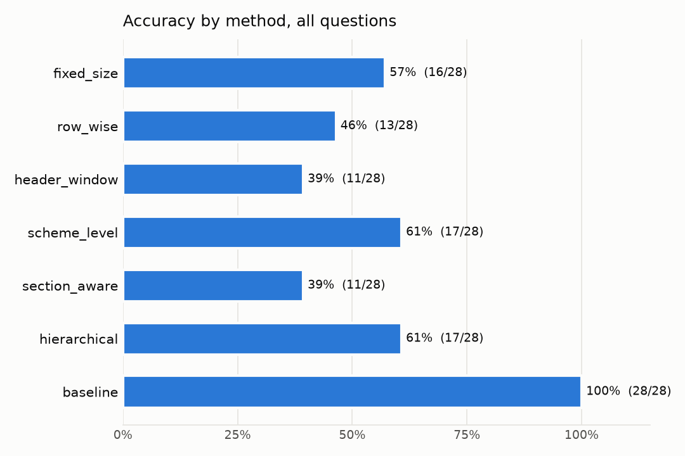

# Evaluation results

Written by `python -m src.eval report` from `results/results.csv` (196 rows: 7 methods × 28 questions).

|  |  |
| --- | --- |
| LLM | `x-ai/grok-4.20` (temperature 0) |
| Embedding | `BAAI/bge-small-en-v1.5`, top_k 5 |
| Run | started 2026-11-20T09:25:20+05:30, 2 session(s), last finished 2026-11-20T10:08:08+05:30 |
| Commit | `4f395cb` (uncommitted changes) |
| Cached answers | 0 of 196 |

## Recommendation

**Best chunking method for this data: hierarchical (final for this run).**

Rule: most correct answers; a tie goes to higher gold-row recall, then to fewer tokens per question. The pandas baseline is compared but not ranked. Full detail: [`chunking_report.xlsx`](chunking_report.xlsx).

- Tied with scheme_level on correct answers (17/28); wins because more of the rows each answer needs reach the LLM (gold-row recall 96% vs 92%).
- Highest accuracy (alone or tied) on: lookup (100%), aggregation (43%), debt (20%), unanswerable (100%).
- Weakest on debt: 20% (1/5). 3 of its 4 wrong answers are labelled generation error: the rows were there but the LLM still answered wrong.
- Weakest on cross_scheme: 40% (2/5). 2 of its 3 wrong answers are labelled retrieval miss: not every row the answer needs reached the LLM (mean gold-row recall 80%). scheme_level does better here (60%).
- Cost: 7,576 tokens per question; the cheapest ranked chunker is row_wise (1,166).
- Refusals: says the data does not contain the answer on 4 of 4 unanswerable questions, and wrongly refuses 2 of 24 answerable ones.

| Question type | Questions | Best method | Accuracy | Decided by |
| --- | --- | --- | --- | --- |
| lookup | 7 | **row_wise** | 100% | fewer tokens (tied on accuracy and recall) |
| aggregation | 7 | **hierarchical** | 43% | fewer tokens (tied on accuracy and recall) |
| debt | 5 | **hierarchical** | 20% | accuracy |
| cross_scheme | 5 | **scheme_level** | 60% | gold-row recall (tied on accuracy) |
| unanswerable | 4 | **row_wise** | 100% | fewer tokens (tied on accuracy and recall) |

The pandas baseline (no chunking; compared, not ranked) gets 100% (28/28) where hierarchical gets 61% (17/28) on the same questions. On aggregation: baseline 7/7, hierarchical 3/7.

## 1. Accuracy by method and question type

Correct answers / questions. Unanswerable questions count as correct when the method says the data does not contain the answer.

| Method | lookup (7) | aggregation (7) | debt (5) | cross_scheme (5) | unanswerable (4) | overall (28) |
| --- | ---: | ---: | ---: | ---: | ---: | ---: |
| **fixed_size** | 100% (7/7) | 29% (2/7) | 0% (0/5) | 60% (3/5) | 100% (4/4) | **57% (16/28)** |
| **row_wise** | 100% (7/7) | 0% (0/7) | 0% (0/5) | 40% (2/5) | 100% (4/4) | **46% (13/28)** |
| **header_window** | 86% (6/7) | 14% (1/7) | 0% (0/5) | 0% (0/5) | 100% (4/4) | **39% (11/28)** |
| **scheme_level** | 100% (7/7) | 43% (3/7) | 0% (0/5) | 60% (3/5) | 100% (4/4) | **61% (17/28)** |
| **section_aware** | 86% (6/7) | 14% (1/7) | 0% (0/5) | 0% (0/5) | 100% (4/4) | **39% (11/28)** |
| **hierarchical** | 100% (7/7) | 43% (3/7) | 20% (1/5) | 40% (2/5) | 100% (4/4) | **61% (17/28)** |
| **baseline** | 100% (7/7) | 100% (7/7) | 100% (5/5) | 100% (5/5) | 100% (4/4) | **100% (28/28)** |

## 2. Retrieval and context size

Answerable questions only. *Hit*: at least one gold row was in the context. *Recall*: share of gold rows in the context (aggregations need all of them). Context tokens use the embedding tokenizer; prompt tokens are the LLM's count of the whole prompt.

| Method | Hit | Gold-row recall | Chunks | Holding rows | Context tokens | Prompt tokens | Accuracy (answerable) |
| --- | ---: | ---: | ---: | ---: | ---: | ---: | ---: |
| **fixed_size** | 83% (20/24) | 58% | 5.0 | 31 | 1,266 | 1,838 | 50% (12/24) |
| **row_wise** | 96% (23/24) | 51% | 5.0 | 5 | 521 | 1,048 | 38% (9/24) |
| **header_window** | 88% (21/24) | 65% | 5.0 | 49 | 2,021 | 2,609 | 29% (7/24) |
| **scheme_level** | 92% (22/24) | 92% | 5.0 | 374 | 13,166 | 14,063 | 54% (13/24) |
| **section_aware** | 88% (21/24) | 60% | 5.0 | 40 | 1,654 | 2,232 | 29% (7/24) |
| **hierarchical** | 100% (24/24) | 96% | 2.8 | 190 | 6,435 | 7,119 | 54% (13/24) |
| **baseline** | – | – | – | – | – | 3,638 | 100% (24/24) |

The baseline has no retrieval: its prompt is the table schema, and the code reads the whole table.

## 3. Tokens and latency

Means per question. Latency of a cached answer is that of its original call.

| Method | Prompt tok | Completion tok | Total tok (all questions) | Retrieval ms | Generation ms | Code run ms | Total ms |
| --- | ---: | ---: | ---: | ---: | ---: | ---: | ---: |
| **fixed_size** | 1,838 | 127 | 55,017 | 19 | 1,973 | – | 1,993 |
| **row_wise** | 1,048 | 118 | 32,643 | 25 | 1,917 | – | 1,942 |
| **header_window** | 2,609 | 288 | 81,115 | 13 | 2,788 | – | 2,801 |
| **scheme_level** | 14,063 | 440 | 406,087 | 11 | 3,805 | – | 3,816 |
| **section_aware** | 2,232 | 236 | 69,121 | 9 | 2,774 | – | 2,783 |
| **hierarchical** | 7,119 | 457 | 212,122 | 8 | 4,156 | – | 4,164 |
| **baseline** | 3,638 | 84 | 104,228 | – | 2,196 | 89 | 2,286 |

## 4. Refusals

| Method | Unanswerable: correctly refused | Answerable: refused anyway (false refusal) |
| --- | ---: | ---: |
| **fixed_size** | 100% (4/4) | 29% (7/24) |
| **row_wise** | 100% (4/4) | 25% (6/24) |
| **header_window** | 100% (4/4) | 33% (8/24) |
| **scheme_level** | 100% (4/4) | 8% (2/24) |
| **section_aware** | 100% (4/4) | 25% (6/24) |
| **hierarchical** | 100% (4/4) | 8% (2/24) |
| **baseline** | 100% (4/4) | 0% (0/24) |

## 5. Status and failure kinds

Rows whose status is not `ok`, and the label of every wrong answer.

| Method | Non-ok status | Wrong answers by kind |
| --- | --- | --- |
| **fixed_size** | all ok | retrieval miss 12 |
| **row_wise** | all ok | retrieval miss 15 |
| **header_window** | format_error 1 | retrieval miss 13, generation error 3, format error 1 |
| **scheme_level** | format_error 2 | generation error 7, format error 2, retrieval miss 2 |
| **section_aware** | format_error 1 | retrieval miss 14, generation error 2, format error 1 |
| **hierarchical** | format_error 2 | generation error 7, format error 2, retrieval miss 2 |
| **baseline** | all ok | none |

## 6. Failure examples

Up to three wrong answers per method, different kinds first. *retrieval miss*: not every gold row reached the LLM; *generation error*: the rows were there (or no retrieval) and the answer is still wrong; *format error*: the reply broke the JSON format; *context overflow*: the provider refused the prompt as too large.

### fixed_size

- **Q08** (aggregation) · *retrieval miss*, gold-row recall 57%  
  Q: What is the total % of AUM in equity holdings of the Banks industry for Aditya Birla Sun Life Flexi Cap Fund as on 30 Sep 2026?  
  Gold: 19.239918634537645 pct  
  Given: value 11.15 pct ("11.15")
- **Q09** (aggregation) · *retrieval miss*, gold-row recall 26%  
  Q: What is the total % of AUM in equity holdings of the IT - Software industry for Aditya Birla Sun Life Digital India Fund as on 30 Sep 2026?  
  Gold: 57.005349052224894 pct  
  Given: value 30.08 pct ("The total % of AUM in equity holdings of the IT - Software industry for Aditya …")
- **Q12** (aggregation) · *retrieval miss*, gold-row recall 10%  
  Q: How many holdings are listed in the Equity & Equity Related section of Aditya Birla Sun Life Large Cap Fund as on 30 Sep 2026?  
  Gold: 71 count  
  Given: "The provided context only shows the first 7 holdings for ADITYA BIRLA SUN LIFE LARGE CAP FUND before it is truncated at "Bhart". The total …"

### row_wise

- **Q08** (aggregation) · *retrieval miss*, gold-row recall 43%  
  Q: What is the total % of AUM in equity holdings of the Banks industry for Aditya Birla Sun Life Flexi Cap Fund as on 30 Sep 2026?  
  Gold: 19.239918634537645 pct  
  Given: value 8.68 pct ("The total % of AUM in equity holdings of the Banks industry is 8.68.")
- **Q09** (aggregation) · *retrieval miss*, gold-row recall 26%  
  Q: What is the total % of AUM in equity holdings of the IT - Software industry for Aditya Birla Sun Life Digital India Fund as on 30 Sep 2026?  
  Gold: 57.005349052224894 pct  
  Given: value 20.16 pct ("The total % of AUM in equity holdings of the IT - Software industry for Aditya …")
- **Q10** (aggregation) · *retrieval miss*, gold-row recall 20%  
  Q: What share of AUM do the top 5 equity holdings (by % of AUM) of Aditya Birla Sun Life Large Cap Fund make up together, as on 30 Sep 2026?  
  Gold: 27.41107504658948 pct  
  Given: "The context only provides 3 equity holdings for Aditya Birla Sun Life Large Cap Fund (Aditya Birla Capital Ltd. at 0.89%, National Stock Ex…"

### header_window

- **Q02** (lookup) · *retrieval miss*, gold-row recall 0%  
  Q: What % of AUM does Aditya Birla Sun Life Large Cap Fund hold in Infosys Ltd. as on 30 Sep 2026?  
  Gold: 3.20302290932626 pct  
  Given: "The context does not contain any holding in Infosys Ltd. for Aditya Birla Sun Life Large Cap Fund."
- **Q09** (aggregation) · *generation error*, gold-row recall 100%  
  Q: What is the total % of AUM in equity holdings of the IT - Software industry for Aditya Birla Sun Life Digital India Fund as on 30 Sep 2026?  
  Gold: 57.005349052224894 pct  
  Given: value 55.13 pct ("The total % of AUM in equity holdings of the IT - Software industry for Aditya …")
- **Q16** (debt) · *format error*, gold-row recall 95%  
  Q: What is the total % of AUM in Government Securities (the Government Securities sub-section of Debt Instruments) for Aditya Birla Sun Life Medium to Long Term Fund as on 30 Sep 2026?  
  Gold: 59.68727676688986 pct  
  Given: status `format_error`: not valid JSON: Unterminated string starting at: line 1 column 6852 (char 6851) (reply cut at max_output_tokens)

### scheme_level

- **Q08** (aggregation) · *generation error*, gold-row recall 100%  
  Q: What is the total % of AUM in equity holdings of the Banks industry for Aditya Birla Sun Life Flexi Cap Fund as on 30 Sep 2026?  
  Gold: 19.239918634537645 pct  
  Given: value 18.23 pct ("The total % of AUM in equity holdings of the Banks industry for Aditya Birla Su…")
- **Q14** (aggregation) · *format error*, gold-row recall 100%  
  Q: What is the total % of AUM in the Equity & Equity Related section of Aditya Birla Sun Life Aggressive Hybrid Fund as on 30 Sep 2026?  
  Gold: 76.18333853980906 pct  
  Given: status `format_error`: not valid JSON: Unterminated string starting at: line 1 column 6228 (char 6227) (reply cut at max_output_tokens)
- **Q15** (debt) · *retrieval miss*, gold-row recall 0%  
  Q: What % of AUM of Aditya Birla Sun Life Medium to Long Term Fund is rated AAA by any agency (CRISIL, ICRA, CARE or IND; not counting securitised AAA(SO) ratings) as on 30 Sep 2026?  
  Gold: 32.41573675914155 pct  
  Given: "insufficient_context"

### section_aware

- **Q02** (lookup) · *retrieval miss*, gold-row recall 0%  
  Q: What % of AUM does Aditya Birla Sun Life Large Cap Fund hold in Infosys Ltd. as on 30 Sep 2026?  
  Gold: 3.20302290932626 pct  
  Given: "The provided context does not contain any equity holdings for ADITYA BIRLA SUN LIFE LARGE CAP FUND (only debt and TREPS/Reverse Repo are sh…"
- **Q09** (aggregation) · *generation error*, gold-row recall 100%  
  Q: What is the total % of AUM in equity holdings of the IT - Software industry for Aditya Birla Sun Life Digital India Fund as on 30 Sep 2026?  
  Gold: 57.005349052224894 pct  
  Given: value 52.13 pct ("The total % of AUM in equity holdings of the IT - Software industry is 52.13%. …")
- **Q16** (debt) · *format error*, gold-row recall 100%  
  Q: What is the total % of AUM in Government Securities (the Government Securities sub-section of Debt Instruments) for Aditya Birla Sun Life Medium to Long Term Fund as on 30 Sep 2026?  
  Gold: 59.68727676688986 pct  
  Given: status `format_error`: not valid JSON: Unterminated string starting at: line 1 column 6866 (char 6865) (reply cut at max_output_tokens)

### hierarchical

- **Q08** (aggregation) · *generation error*, gold-row recall 100%  
  Q: What is the total % of AUM in equity holdings of the Banks industry for Aditya Birla Sun Life Flexi Cap Fund as on 30 Sep 2026?  
  Gold: 19.239918634537645 pct  
  Given: value 18.23 pct ("The total % of AUM in equity holdings of the Banks industry is 18.23%.")
- **Q14** (aggregation) · *format error*, gold-row recall 100%  
  Q: What is the total % of AUM in the Equity & Equity Related section of Aditya Birla Sun Life Aggressive Hybrid Fund as on 30 Sep 2026?  
  Gold: 76.18333853980906 pct  
  Given: status `format_error`: not valid JSON: Unterminated string starting at: line 1 column 6263 (char 6262) (reply cut at max_output_tokens)
- **Q21** (cross_scheme) · *retrieval miss*, gold-row recall 50%  
  Q: Which holds more HDFC Bank Ltd. as a % of AUM as on 30 Sep 2026: Aditya Birla Sun Life Flexi Cap Fund or Aditya Birla Sun Life Value Fund?  
  Gold: "PURE"  
  Given: value 3.91 pct ("Aditya Birla Sun Life Flexi Cap Fund holds 3.91% of AUM in HDFC Bank Ltd.")

### baseline

No wrong answers.
