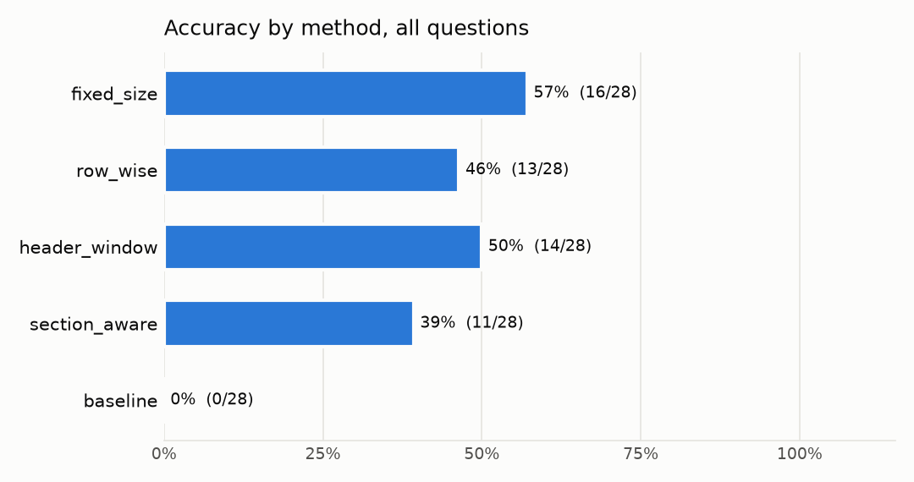

# Evaluation results

Written by `python -m src.eval report` from `results/results.csv` (140 rows: 5 methods × 28 questions).

|  |  |
| --- | --- |
| LLM | groq / `openai/gpt-oss-120b` (temperature 0) |
| Embedding | `BAAI/bge-small-en-v1.5`, top_k 5 |
| Run | started 2026-11-14T10:35:41+05:30, 2 session(s), last finished 2026-11-14T11:57:47+05:30 |
| Commit | `9c2f014` (uncommitted changes) |
| Cached answers | 0 of 140 |

> **Not run in this run:** `scheme_level`, `hierarchical`. They are missing from every table below, so do not compare them by absence.

> **Not a complete run.** 33 row(s) still pending (rate limit, provider down, or answered by the fallback model); run `python -m src.eval run` again. The manifest does not mark the run complete.

## 1. Accuracy by method and question type

Correct answers / questions. Unanswerable questions count as correct when the method says the data does not contain the answer.

| Method | lookup (7) | aggregation (7) | debt (5) | cross_scheme (5) | unanswerable (4) | overall (28) |
| --- | ---: | ---: | ---: | ---: | ---: | ---: |
| **fixed_size** | 100% (7/7) | 29% (2/7) | 0% (0/5) | 60% (3/5) | 100% (4/4) | **57% (16/28)** |
| **row_wise** | 100% (7/7) | 0% (0/7) | 0% (0/5) | 40% (2/5) | 100% (4/4) | **46% (13/28)** |
| **header_window** | 86% (6/7) | 29% (2/7) | 0% (0/5) | 40% (2/5) | 100% (4/4) | **50% (14/28)** |
| **section_aware** | 86% (6/7) | 29% (2/7) | 0% (0/5) | 60% (3/5) | 0% (0/4) | **39% (11/28)** |
| **baseline** | 0% (0/7) | 0% (0/7) | 0% (0/5) | 0% (0/5) | 0% (0/4) | **0% (0/28)** |

## 2. Retrieval and context size

Answerable questions only. *Hit*: at least one gold row was in the context. *Recall*: share of gold rows in the context (aggregations need all of them). Context tokens use the embedding tokenizer; prompt tokens are the LLM's count of the whole prompt.

| Method | Hit | Gold-row recall | Chunks | Holding rows | Context tokens | Prompt tokens | Accuracy (answerable) |
| --- | ---: | ---: | ---: | ---: | ---: | ---: | ---: |
| **fixed_size** | 83% (20/24) | 58% | 5.0 | 31 | 1,266 | 1,747 | 50% (12/24) |
| **row_wise** | 96% (23/24) | 51% | 5.0 | 5 | 522 | 952 | 38% (9/24) |
| **header_window** | 88% (21/24) | 65% | 5.0 | 49 | 2,021 | 2,525 | 42% (10/24) |
| **section_aware** | 88% (21/24) | 60% | 5.0 | 40 | 1,654 | 1,833 | 46% (11/24) |
| **baseline** | – | – | – | – | – | 0 | 0% (0/24) |

The baseline has no retrieval: its prompt is the table schema, and the code reads the whole table.

## 3. Tokens and latency

Means per question. Latency of a cached answer is that of its original call.

| Method | Prompt tok | Completion tok | Total tok (all questions) | Retrieval ms | Generation ms | Code run ms | Total ms |
| --- | ---: | ---: | ---: | ---: | ---: | ---: | ---: |
| **fixed_size** | 1,747 | 198 | 54,472 | 24 | 1,783 | – | 1,807 |
| **row_wise** | 952 | 160 | 31,130 | 11 | 1,150 | – | 1,161 |
| **header_window** | 2,525 | 362 | 80,840 | 11 | 1,746 | – | 1,757 |
| **section_aware** | 1,833 | 354 | 61,239 | 16 | 1,736 | – | 1,752 |
| **baseline** | 0 | 0 | 0 | – | 0 | 0 | 0 |

## 4. Refusals

| Method | Unanswerable: correctly refused | Answerable: refused anyway (false refusal) |
| --- | ---: | ---: |
| **fixed_size** | 100% (4/4) | 29% (7/24) |
| **row_wise** | 100% (4/4) | 12% (3/24) |
| **header_window** | 100% (4/4) | 25% (6/24) |
| **section_aware** | 0% (0/4) | 21% (5/24) |
| **baseline** | 0% (0/4) | 0% (0/24) |

## 5. Status and failure kinds

Rows whose status is not `ok`, and the label of every wrong answer.

| Method | Non-ok status | Wrong answers by kind |
| --- | --- | --- |
| **fixed_size** | all ok | retrieval miss 12 |
| **row_wise** | all ok | retrieval miss 15 |
| **header_window** | format_error 1 | retrieval miss 11, generation error 2, format error 1 |
| **section_aware** | rate_limited 5, format_error 2 | retrieval miss 9, generation error 6, format error 2 |
| **baseline** | rate_limited 28 | generation error 28 |

## 6. Failure examples

Up to three wrong answers per method, different kinds first. *retrieval miss*: not every gold row reached the LLM; *generation error*: the rows were there (or no retrieval) and the answer is still wrong; *format error*: the reply broke the JSON format; *context overflow*: the provider refused the prompt as too large.

### fixed_size

- **Q08** (aggregation) · *retrieval miss*, gold-row recall 57%  
  Q: What is the total % of AUM in equity holdings of the Banks industry for Aditya Birla Sun Life Flexi Cap Fund as on 30 Sep 2026?  
  Gold: 19.239918634537645 pct  
  Given: value 15.15 pct ("The banks sector accounts for 15.15% of AUM in equity holdings of the Aditya Bi…")
- **Q09** (aggregation) · *retrieval miss*, gold-row recall 26%  
  Q: What is the total % of AUM in equity holdings of the IT - Software industry for Aditya Birla Sun Life Digital India Fund as on 30 Sep 2026?  
  Gold: 57.005349052224894 pct  
  Given: value 30.08 pct ("The IT‑Software equity holdings represent 30.08% of the AUM.")
- **Q12** (aggregation) · *retrieval miss*, gold-row recall 10%  
  Q: How many holdings are listed in the Equity & Equity Related section of Aditya Birla Sun Life Large Cap Fund as on 30 Sep 2026?  
  Gold: 71 count  
  Given: value 6 count ("There are 6 holdings listed in the Equity & Equity Related section of the Adity…")

### row_wise

- **Q08** (aggregation) · *retrieval miss*, gold-row recall 43%  
  Q: What is the total % of AUM in equity holdings of the Banks industry for Aditya Birla Sun Life Flexi Cap Fund as on 30 Sep 2026?  
  Gold: 19.239918634537645 pct  
  Given: value 8.68 pct ("The total percentage of AUM in equity holdings for the Banks industry is 8.68%.")
- **Q09** (aggregation) · *retrieval miss*, gold-row recall 26%  
  Q: What is the total % of AUM in equity holdings of the IT - Software industry for Aditya Birla Sun Life Digital India Fund as on 30 Sep 2026?  
  Gold: 57.005349052224894 pct  
  Given: value 20.16 pct ("The total percentage of AUM in equity holdings for the IT - Software industry i…")
- **Q10** (aggregation) · *retrieval miss*, gold-row recall 20%  
  Q: What share of AUM do the top 5 equity holdings (by % of AUM) of Aditya Birla Sun Life Large Cap Fund make up together, as on 30 Sep 2026?  
  Gold: 27.41107504658948 pct  
  Given: "Insufficient data to determine the combined % of the top 5 equity holdings as only three equity holdings are provided in the context."

### header_window

- **Q02** (lookup) · *retrieval miss*, gold-row recall 0%  
  Q: What % of AUM does Aditya Birla Sun Life Large Cap Fund hold in Infosys Ltd. as on 30 Sep 2026?  
  Gold: 3.20302290932626 pct  
  Given: "Insufficient context to determine the % of AUM for Infosys Ltd. in ADITYA BIRLA SUN LIFE LARGE CAP FUND as on 30 Sep 2026."
- **Q13** (aggregation) · *generation error*, gold-row recall 100%  
  Q: How many holdings are listed in the Equity & Equity Related section of Aditya Birla Sun Life Focused Fund as on 30 Sep 2026?  
  Gold: 29 count  
  Given: value 20 count ("There are 20 holdings listed in the Equity & Equity Related section of the Adit…")
- **Q14** (aggregation) · *format error*, gold-row recall 61%  
  Q: What is the total % of AUM in the Equity & Equity Related section of Aditya Birla Sun Life Aggressive Hybrid Fund as on 30 Sep 2026?  
  Gold: 76.18333853980906 pct  
  Given: status `format_error`: missing keys: ['insufficient_context'] (reply cut at max_output_tokens)

### section_aware

- **Q02** (lookup) · *retrieval miss*, gold-row recall 0%  
  Q: What % of AUM does Aditya Birla Sun Life Large Cap Fund hold in Infosys Ltd. as on 30 Sep 2026?  
  Gold: 3.20302290932626 pct  
  Given: "Insufficient context to determine the % of AUM for Infosys Ltd. in Aditya Birla Sun Life Large Cap Fund as of 30 Sep 2026."
- **Q14** (aggregation) · *format error*, gold-row recall 63%  
  Q: What is the total % of AUM in the Equity & Equity Related section of Aditya Birla Sun Life Aggressive Hybrid Fund as on 30 Sep 2026?  
  Gold: 76.18333853980906 pct  
  Given: status `format_error`: missing keys: ['insufficient_context'] (reply cut at max_output_tokens)
- **Q18** (debt) · *generation error*, gold-row recall 100%  
  Q: List all holdings of Aditya Birla Sun Life Credit Risk Fund rated IND AA- as on 30 Sep 2026.  
  Gold: ["9.10% SK Finance Ltd. (10/08/2029) **", "8.45% Adani Airport Holdings Ltd. (12/02/2029) **", "8.50% IKF Finance Ltd. (10/03/2028) **"]  
  Given: items SK Finance Ltd.; Adani Airport Holdings Ltd.; IKF Finance Ltd.

### baseline

- **Q01** (lookup) · *generation error*  
  Q: What % of AUM does Aditya Birla Sun Life Flexi Cap Fund hold in ICICI Bank Ltd. as on 30 Sep 2026?  
  Gold: 5.59673125081035 pct  
  Given: status `rate_limited`: Error code: 429 - {'error': {'message': 'Rate limit reached for model `openai/gpt-oss-120b` in organization `org_<redac…
- **Q02** (lookup) · *generation error*  
  Q: What % of AUM does Aditya Birla Sun Life Large Cap Fund hold in Infosys Ltd. as on 30 Sep 2026?  
  Gold: 3.20302290932626 pct  
  Given: status `rate_limited`: Error code: 429 - {'error': {'message': 'Rate limit reached for model `openai/gpt-oss-120b` in organization `org_<redac…
- **Q03** (lookup) · *generation error*  
  Q: What % of AUM does Aditya Birla Sun Life Small Cap Fund hold in TD Power Systems Ltd. as on 30 Sep 2026?  
  Gold: 3.3895195224851395 pct  
  Given: status `rate_limited`: Error code: 429 - {'error': {'message': 'Rate limit reached for model `openai/gpt-oss-120b` in organization `org_<redac…
